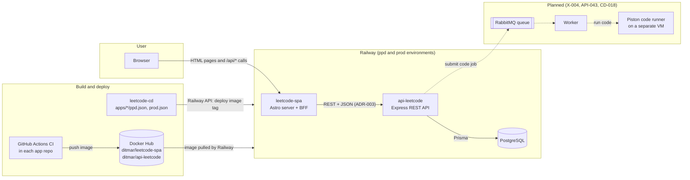

# Architecture overview

This page explains how the LeetCode clone fits together: which repository does what, how data moves, and where to put new code. Read it before your first ticket.

The project has three repositories:

| Repository                                               | What it is                                                                                         | Main technologies                                                               |
| -------------------------------------------------------- | -------------------------------------------------------------------------------------------------- | ------------------------------------------------------------------------------- |
| [`leetcode-spa`](https://github.com/Ditmar/leetcode-spa) | The web application. Pages, components and the server side of the web app (BFF).                   | Astro (Node adapter, `output: 'server'`), React islands, MUI, Vitest, Storybook |
| [`api-leetcode`](https://github.com/Ditmar/api-leetcode) | The REST API. Business rules and access to the database.                                           | Express, TypeScript, Prisma, PostgreSQL, Zod, Pino                              |
| [`leetcode-cd`](https://github.com/Ditmar/leetcode-cd)   | Continuous deployment. Says which Docker image runs in each environment and deploys it to Railway. | GitHub Actions, Bash scripts, Railway API                                       |

Decisions that shape this architecture are written as ADRs in [`docs/decisions/`](decisions/) and in the decision tickets (`X-001` to `X-008`).

## System diagram



Dotted lines are **planned**. Today the API does not run user code (see [X-004](https://github.com/Ditmar/leetcode-spa/issues/369)).

### How a request moves

1. The browser asks the **Astro server** for a page, for example `/problems`.
2. The Astro page (`src/pages/*.astro`) loads the first data **on the server** (SSR) by calling the API, and renders the HTML.
3. The browser loads the **React island** of the page. When the user changes something (a filter, a page), the island calls the data again through the services in `src/services/`.
4. The **API** checks the request, runs a use case and reads or writes **PostgreSQL** through Prisma.
5. The answer uses the contract in [ADR-003](decisions/ADR-003-api-contract.md): `{ data, meta? }` for success and `{ code, message, details? }` for errors.

### Login and tokens (BFF)

The browser never keeps API tokens. The decision in [X-002](https://github.com/Ditmar/leetcode-spa/issues/367) is a **BFF (Backend For Frontend) in Astro**: Astro server routes call the real API and keep the tokens in `HttpOnly` cookies. The proxy and BFF routes are built in `SPA-036`, and the SPA services are adapted in `SPA-001` to `SPA-007`.

### How code goes to production

1. Work on a branch named `feature/leetcode-{ticket}` and open a pull request **against `next`**, never against `master`. Every push runs the CI checks (lint, tests, Storybook build).
2. After review and approval, the pull request is merged into **`next`**.
3. For a release, a **release pull request** merges `next` into `master` (for example [#453](https://github.com/Ditmar/leetcode-spa/pull/453)).
4. On `master`, the CI job "Release (master only)" (`.github/workflows/ci.yml`) creates the release (version number, changelog and tag). Then the CI pushes the Docker image to **Docker Hub** with that version, for example `ditmar/leetcode-spa:0.12.0`. Pushes to other branches only build preview images tagged `<version>-<commit>`.
5. Someone changes the image tag in `leetcode-cd/apps/<app>/ppd.json` (pre-production) through a pull request.
6. When that change is merged, the `deploy.yml` workflow of `leetcode-cd` validates that the image exists and asks **Railway** to deploy it.
7. After checking `ppd`, the same image is **promoted** to `prod.json` (`promote.yml`). `rollback.yml` goes back to an earlier image.

The same image is built once and promoted. It is never rebuilt for production.

## API (`api-leetcode`): hexagonal folders

The API is organized by **module** (a business area), and every module has the same three layers. This style is called **hexagonal architecture** or **ports and adapters**.

```text
src/
├── auth/              ← one module per business area
│   ├── domain/        ← entities, value objects, errors, repository interfaces
│   ├── application/   ← use cases (one folder per action)
│   └── infrastructure/
│       ├── controller/   ← Express controllers (HTTP in and out)
│       ├── repository/   ← Prisma implementations of the domain repositories
│       ├── middleware/
│       └── routes/       ← Express routers
├── course/  tests/  user/   ← other modules with the same layers
├── share/infrastructure/    ← shared code: Prisma client, auth middleware, services.ts
├── config/                  ← typed configuration (node-config + schema)
├── logger/                  ← Pino logger
└── index.ts                 ← creates the Express app and mounts the routers
prisma/schema.prisma         ← database models and migrations
```

Example from the `course` module:

| Layer          | File                                                     | What it does                                                                                |
| -------------- | -------------------------------------------------------- | ------------------------------------------------------------------------------------------- |
| Domain         | `domain/course.ts`, `domain/course-title.ts`             | The `Course` entity and its value objects. No Express, no Prisma.                           |
| Domain         | `domain/repository/course-repository.ts`                 | The **port**: an interface that says what the module needs (`getAll`, `getById`, `create`). |
| Application    | `application/course-get-all/course-get-all.ts`           | The use case `CourseGetAll`. It receives a `CourseRepository` in the constructor.           |
| Infrastructure | `infrastructure/repository/course-prisma-repository.ts`  | The **adapter**: implements `CourseRepository` with Prisma.                                 |
| Infrastructure | `infrastructure/controller/express-course-controller.ts` | Reads the HTTP request, calls the use case, writes the HTTP response.                       |
| Infrastructure | `infrastructure/routes/course-routes.ts`                 | Maps URLs to controller methods.                                                            |

### What can import what

| From             | Can import                                                     | Must not import                                  |
| ---------------- | -------------------------------------------------------------- | ------------------------------------------------ |
| `domain`         | Only other `domain` files of the same module                   | `application`, `infrastructure`, Express, Prisma |
| `application`    | `domain`                                                       | `infrastructure`, Express, Prisma                |
| `infrastructure` | `application`, `domain`, Express, Prisma, `@config`, `@logger` | —                                                |

Dependencies always point **inwards**: infrastructure → application → domain. This lets us test use cases with a fake repository and change the database without touching business rules.

Today the use cases and repositories are created in `src/share/infrastructure/services.ts`. `API-021` moves this into one place where all dependencies are connected (a composition root). Some module folders still have old names (for example `tests/infraestructure`); `API-020` cleans this up.

## SPA (`leetcode-spa`): folders

```text
src/
├── pages/             ← Astro routes: one file = one URL (problems.astro → /problems)
├── layouts/           ← page shells (BaseLayout.astro)
├── ui/components/     ← page-level React components (Problems.tsx, HomePage.tsx…)
│   ├── common/        ← shared page parts (NavShell)
│   └── problems/      ← pieces used only by one page (added by SPA-017, PR #458)
├── app/components/    ← app features used across pages (AuthModal, HomeAuthGate)
├── component-catalog/ ← reusable, generic UI components (Pagination, input, Badge…), each with tests and stories
├── style-library/     ← MUI theme, providers (ClientOnlyMuiProvider), SSR style helpers
├── services/          ← API calls, one folder per area (problems, auth, submissions…); api/ has apiClient
├── context/           ← React contexts (AppConfigContext)
├── config/            ← default.json and env.json (navigation, app settings)
├── utils/             ← helpers (config loading, fetchWithCache)
├── i18n/              ← translations
└── test/              ← test setup and test utilities
```

| Folder               | Put here                                                              | Do not put here                                              |
| -------------------- | --------------------------------------------------------------------- | ------------------------------------------------------------ |
| `component-catalog/` | Generic components that know nothing about problems, users or the API | Components that call services                                |
| `ui/components/`     | The React component of a page and its pieces                          | Generic components used by many pages                        |
| `services/`          | Functions that call the API and their types                           | React code                                                   |
| `pages/`             | `.astro` route files and server routes                                | React components (Astro tries to treat files here as routes) |

Note: `src/pages/ProblemList/` holds React files inside `pages/`. Astro prints a warning for it. New components should go to `ui/components/` instead.

## Where do I put new code?

| I want to…                                    | Repository               | Where                                                                                                                                                                                            |
| --------------------------------------------- | ------------------------ | ------------------------------------------------------------------------------------------------------------------------------------------------------------------------------------------------ |
| Add a new API endpoint to an existing module  | `api-leetcode`           | Use case in `src/<module>/application/<action>/`, controller method in `infrastructure/controller/`, route in `infrastructure/routes/`. Wire the use case in `share/infrastructure/services.ts`. |
| Add a new API module (for example `problems`) | `api-leetcode`           | New folder `src/<module>/` with `domain/`, `application/`, `infrastructure/`. Mount its router in `src/index.ts`.                                                                                |
| Change the database                           | `api-leetcode`           | `prisma/schema.prisma`, then create a migration with Prisma.                                                                                                                                     |
| Add example data                              | `api-leetcode`           | The seed script (`API-027`, see ADR-005 in [PR #459](https://github.com/Ditmar/leetcode-spa/pull/459)).                                                                                          |
| Add a new SPA page                            | `leetcode-spa`           | `src/pages/<route>.astro` + page component in `src/ui/components/<Page>.tsx` inside `NavShell`. Add the link in `src/config/default.json` if it goes in the navigation.                          |
| Call a new API endpoint from the SPA          | `leetcode-spa`           | `src/services/<area>/` (service + types + tests), using `apiClient`.                                                                                                                             |
| Add a reusable UI component                   | `leetcode-spa`           | `src/component-catalog/<Component>/` with `.tsx`, `.types.ts`, `.test.tsx` and `.stories.tsx`.                                                                                                   |
| Change colors or fonts                        | `leetcode-spa`           | `src/style-library/theme/`                                                                                                                                                                       |
| Deploy a new version                          | `leetcode-cd`            | Change the image tag in `apps/<app>/ppd.json` by pull request, then promote to `prod.json`.                                                                                                      |
| Add or change an environment variable         | app repo + `leetcode-cd` | Config schema in the app, and `apps/<app>/variables.example.env` in `leetcode-cd`.                                                                                                               |
| Record an important technical decision        | `leetcode-spa`           | A new ADR in `docs/decisions/ADR-00N-<topic>.md`.                                                                                                                                                |

## Glossary

| Term               | Meaning                                                                                                                                                                             |
| ------------------ | ----------------------------------------------------------------------------------------------------------------------------------------------------------------------------------- |
| **ADR**            | Architecture Decision Record. A short document that records one technical decision: context, options, decision and consequences. Stored in `docs/decisions/`.                       |
| **BFF**            | Backend For Frontend. A small server layer made only for one frontend. Here, Astro server routes call the API and keep tokens in cookies so the browser JavaScript never sees them. |
| **RBAC**           | Role-Based Access Control. Permissions depend on the user's role (for example `USER` or `ADMIN`). Added in `API-026`.                                                               |
| **Sandbox**        | An isolated place to run code that we do not trust, with limits on time, memory, files and network. User code must never run inside the API process (X-004).                        |
| **Migration**      | A versioned file that changes the database structure (tables, columns). Prisma creates and applies migrations from `schema.prisma`.                                                 |
| **Island (Astro)** | An interactive React component inside an Astro page. The rest of the page is plain HTML; only the island loads JavaScript (for example `<ProblemsPage client:load />`).             |
| **SSR**            | Server-Side Rendering. The server builds the HTML before sending it, so the first view is fast and works without JavaScript.                                                        |
| **Port / Adapter** | In hexagonal architecture, a port is an interface the domain needs (for example `CourseRepository`); an adapter implements it with a real technology (for example Prisma).          |
| **Use case**       | One action of the application (for example `CourseGetAll`). Lives in `application/`.                                                                                                |
| **Promotion**      | Deploying to `prod` the same Docker image that was already checked in `ppd`.                                                                                                        |

## Related documents

- [Development plan](development-plan/DEVELOPMENT-PLAN.md) and [ticket index](development-plan/TICKETS-INDEX.md)
- [ADR-003: Unified API contract](decisions/ADR-003-api-contract.md)
- ADR-005: How content is created (proposed in [PR #459](https://github.com/Ditmar/leetcode-spa/pull/459), X-008)
- [`leetcode-cd` README](https://github.com/Ditmar/leetcode-cd#readme): deployment details
